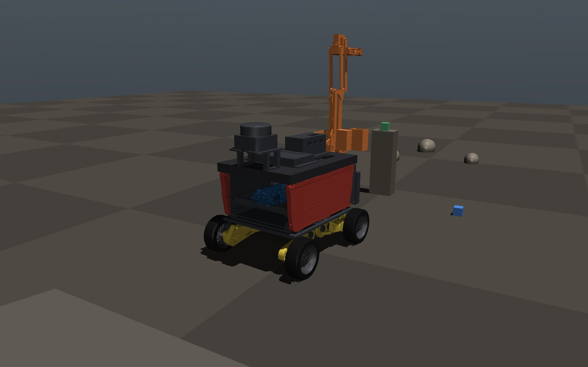
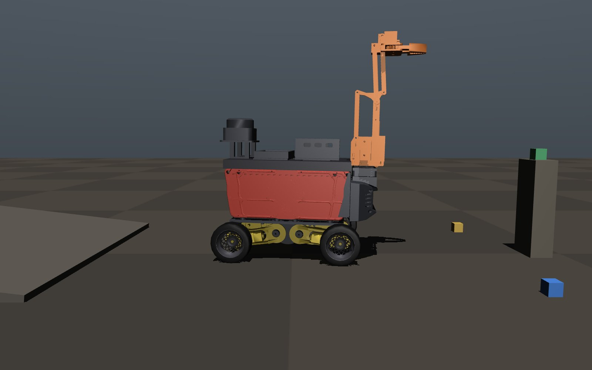
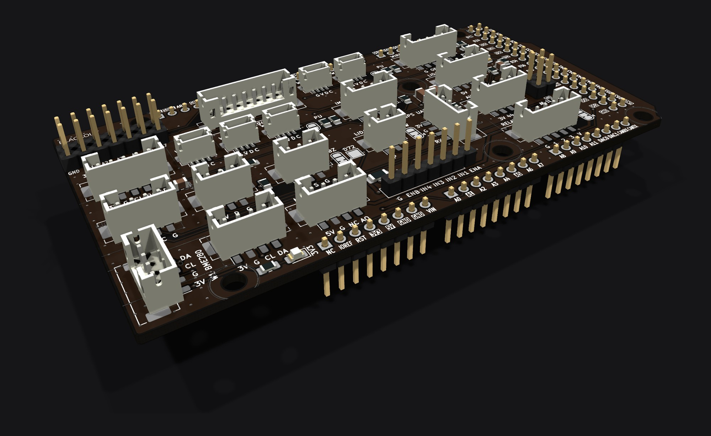
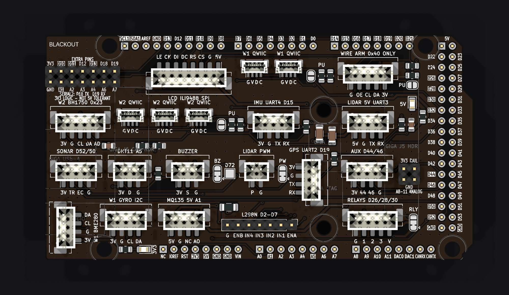

wro 2026 project. future innovators.

single arduino giga r1 wifi (sensors, ble) + node.js dashboard.

<p>
  
  
  
  
</p>

## project layout

```
├── firmware/
│   ├── giga/main/       giga r1 wifi — sensors, motors, arm, ble (main.ino + one .h per section)
│   ├── giga/i2c_scan/   i2c bus diagnostic
│   ├── giga/motor_test/ bench motor check
│   ├── esp32-cam/main/  esp32-cam — mjpeg streamer / usb frame server
│   └── uno-r4/          bench sketches
├── server/
│   ├── server.js        entry: loads src/ and listens (electron forks this)
│   ├── mcp.mjs          mcp stdio server for claude desktop / code
│   ├── src/             server modules (link, telemetry, cam, tts, …) + sage/ (the ai agent)
│   ├── public/          dashboard: index.html, js/app.js + js/ui/ components, lib modules
│   ├── prompts/         sage's system prompts
│   ├── data/            recorded arm takes, tapes, blk workflows
│   ├── test/            npm run test:<name>
│   └── tools/           bench tools (armrec.py, …)
├── electron/            desktop shell (custom ble picker)
├── scripts/             flash.sh, arm-configurator.sh, docs.sh
├── docs/
├── archive/             retired mega 2560 + uno r3 setup (porting reference only)
└── hardware/            cad/ + step/ (local, not in git)
```
